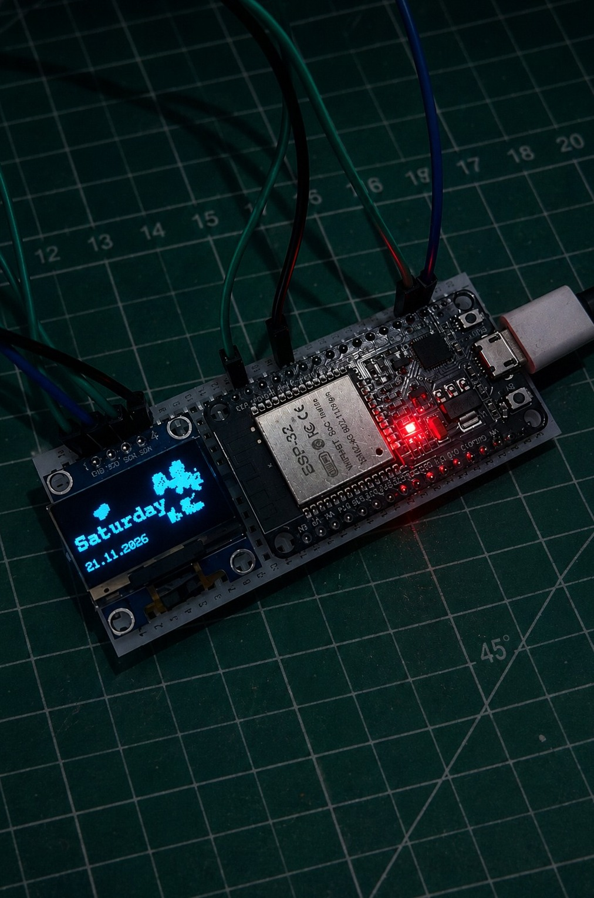
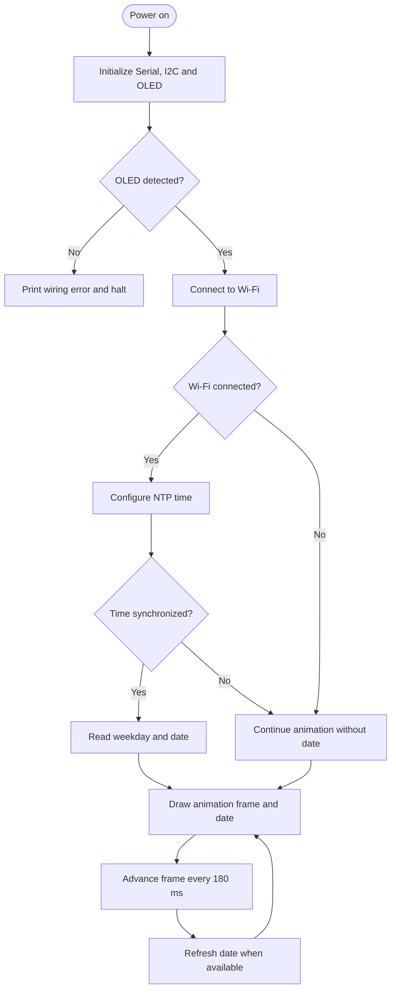
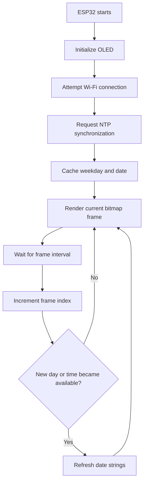

# ESP32 OLED Clock

<p align="center">
  <strong>A tiny desk clock with a little pixel-art personality.</strong><br>
  ESP32 · SSD1306 OLED · NTP time sync · Butterfly animation
</p>

<p align="center">
  
  
  
</p>

---

## Project showcase

<p align="center">
  
</p>

<p align="center"><sub>ESP32 + 128×64 OLED · Cyan butterfly animation · IST date display</sub></p>

## Overview

This project turns an ESP32 and a 128×64 monochrome OLED into a compact digital clock. A cyan pixel-art butterfly animation plays on the display, with the current weekday and date rendered over it. The ESP32 connects to Wi-Fi and synchronizes its clock using an NTP server.

## At a glance

| Part | Details |
| --- | --- |
| Microcontroller | ESP32 development board |
| Display | 0.96-inch 128×64 SSD1306 OLED |
| Display interface | I²C, address `0x3C` |
| Animation | 32 bitmap frames |
| Time source | NTP via Wi-Fi |
| Time zone | IST, UTC+05:30 |
| Date format | `DD.MM.YYYY` |
| Frame interval | 180 ms |

## How it works



## Hardware and wiring

You will need:

- ESP32 development board
- 0.96-inch 128×64 SSD1306 I²C OLED
- Four jumper wires
- USB cable and a Wi-Fi network

### OLED pinout

| OLED pin | ESP32 pin |
| --- | --- |
| VCC | 3.3V (or the supply supported by your OLED module) |
| GND | GND |
| SDA | GPIO 21 |
| SCL | GPIO 22 |

The sketch is configured for I²C address `0x3C`. If your display uses a different address, update `OLED_ADDR` in the sketch.

## Software setup

1. Install the **Arduino IDE**.
2. Install **Adafruit GFX Library** and **Adafruit SSD1306** from Library Manager.
3. Open `ESP32_OLED_Clock/ESP32_OLED_Clock.ino`.
4. Keep `oled_animation.h` in the same sketch folder.
5. Enter your Wi-Fi name and password in the two placeholder constants.
6. Select your ESP32 board and its connected port.
7. Upload the sketch, then open Serial Monitor at **115200 baud**.

### Wi-Fi configuration

In the sketch, replace:

```cpp
const char* WIFI_SSID = "YOUR_WIFI_SSID";
const char* WIFI_PASSWORD = "YOUR_WIFI_PASSWORD";
```

Use your own local credentials. Do not commit real Wi-Fi passwords to a public repository.

## Firmware flow



More diagrams are available in [the flowcharts guide](docs/flowcharts.md).

## Repository structure

```text
esp32-oled-clock/
├── ESP32_OLED_Clock/
│   ├── ESP32_OLED_Clock.ino
│   └── oled_animation.h
├── docs/
│   └── flowcharts.md
├── esp32-oled-clock.jpg
└── README.md
```

## Troubleshooting

| Issue | Things to check |
| --- | --- |
| OLED not detected | Check SDA, SCL, power, GND and I²C address |
| Animation runs but date is missing | Check Wi-Fi credentials and internet access |
| Serial Monitor shows Wi-Fi failure | Confirm the network name and password |
| Display is blank | Confirm the OLED is SSD1306-compatible and uses the configured address |

## Notes

- The clock requires Wi-Fi to obtain accurate time after startup.
- The configured time zone is India Standard Time (UTC+05:30).
- If Wi-Fi is unavailable, the animation can still run, but the date will not be available until time synchronization succeeds.
- The display is monochrome; the cyan look in the reference is the OLED's visual appearance, not a colour output from the SSD1306 panel.

## Credits

**Created by Kushagra Gupta.**

Designed, programmed, and documented as a personal ESP32 electronics project.

---

<p align="center">
  <sub>ESP32 OLED Clock · A small project in embedded systems and display animation</sub>
</p>
