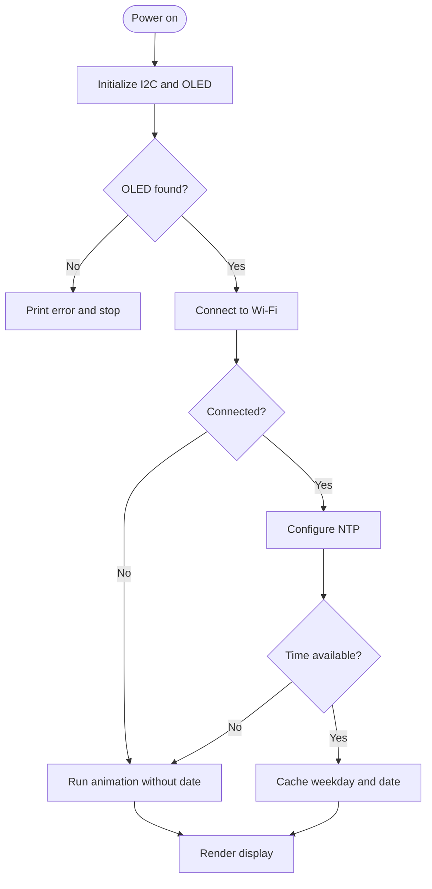
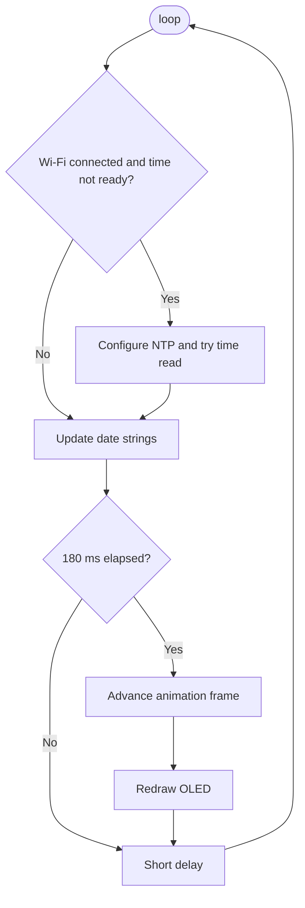

# Project flowcharts

These diagrams document the firmware's current behavior.

## Startup and time synchronization

## Main animation loop

## Display layout

The firmware draws one 128×64 bitmap frame, then overlays the weekday and date when time is available. The exact text placement is set in `drawScreen()`.
